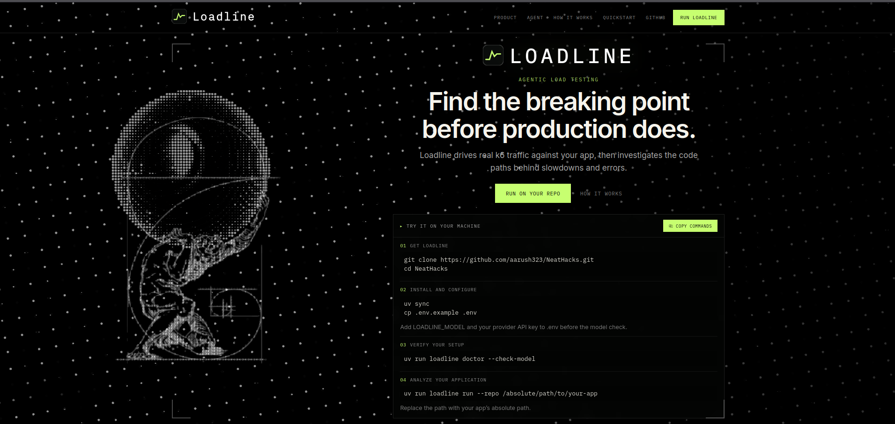

# Loadline

**Find the breaking point before production does.**

Loadline boots your application in isolated Docker, drives HTTP load with [k6](https://k6.io), and runs an investigator that reads the repository and writes a capacity report—or a named blocker when the run cannot continue.

Install from this repository (`uv sync`; no PyPI package).

<p align="center">
  <a href="website/">
    
  </a>
</p>

<p align="center">
  <sub>Landing page source: <a href="website/">website/</a> · Operator guide: <a href="setup.md">setup.md</a></sub>
</p>

---

## Quick start

```bash
git clone https://github.com/aarush323/NeatHacks.git
cd NeatHacks
uv sync
cp .env.example .env
# Set LOADLINE_MODEL and the matching provider API key in .env

uv run loadline doctor
uv run loadline doctor --check-model
uv run loadline load  --repo /absolute/path/to/your-app
uv run loadline run   --repo /absolute/path/to/your-app
```

| Step | Command | Outcome |
|------|---------|---------|
| Boot config | `loadline load --repo <path>` | Trial boot, saved `loadline.yaml`. No report. |
| Investigation | `loadline run --repo <path>` | Boot, load tests, `report.md`, teardown. Does not run `load`. |
| History | `loadline dashboard` / `dashboard --serve` | Browse past runs. |

Use **absolute** paths for `--repo`. Target app env (Compose, DB, secrets) is discovered at boot—not in Loadline’s `.env`.

---

## Requirements

| | |
|---|---|
| Runtime | [Python 3.12](https://www.python.org/) (`>=3.12,<3.13`), [uv](https://docs.astral.sh/uv/) |
| Host | [Git](https://git-scm.com/) 2.36+, [Docker](https://docs.docker.com/) with Compose v2 |
| `loadline run` | `LOADLINE_MODEL` plus `OPENAI_API_KEY`, `ANTHROPIC_API_KEY`, or `OPENROUTER_API_KEY` |
| Optional | [neatlogs](https://neatlogs.com) (`NEATLOGS_*`) for traces |

`loadline doctor` checks the environment; it does not install OS packages. `doctor --cleanup` removes resources labelled `loadline.run=*`.

---

## `loadline run` pipeline

1. Preflight — model and API key before Docker.
2. Boot — Compose from repo hints, `.loadline.yaml`, and/or config from `load`.
3. Investigate — [Pydantic AI](https://ai.pydantic.dev/) agent with fixed tools (below).
4. Report — final message → `$LOADLINE_HOME/runs/<run_id>/report.md`.
5. Teardown — labelled containers, networks, volumes.

The agent does not modify the target repo or open pull requests.

### Investigator tools

| Tool | Function |
|------|----------|
| `repo` | [Entire Graph](https://docs.entire.io/cli-reference/graph) search and navigation; route listing; ripgrep if graph coverage is degraded. |
| `read_file` | Line-bounded source reads for citations (secret paths refused). |
| `run_k6` | One structured experiment per call—endpoints, fixed rate, duration. Loadline compiles and runs k6 on the internal network. |

k6 produces metrics; the investigator ties them to code. No free-form k6 scripts from the model.

Prompt: `agents/investigator_prompt.md` · Code: `loadline/investigator/`

---

## `loadline load`

Deterministic: Docker check → compose/Dockerfile discovery → service and health resolution → trial boot (then tear down) → write config under `LOADLINE_HOME/configs/`. Optional `--write-to-repo` for `.loadline.yaml` in the app repo.

---

## Stack

| | |
|---|---|
| Load | [k6](https://k6.io/docs/) |
| Code graph | [Entire](https://docs.entire.io/) |
| Agent | [Pydantic AI](https://ai.pydantic.dev/) |
| Traces | [neatlogs](https://neatlogs.com) (optional) |
| Isolation | Docker Compose, labelled teardown |

---

## Repository map

| | Path |
|---|------|
| CLI | `loadline/cli.py` |
| `run` | `loadline/run_pipeline.py` |
| `load` | `loadline/load/` |
| Investigator | `loadline/investigator/` |
| k6 | `loadline/adapters/generator/` |
| Dashboard | `loadline/dashboard/`, `loadline/ui/` |
| Site | `website/` |
| Scope | `mvp.md` |

More detail: [setup.md](setup.md)
